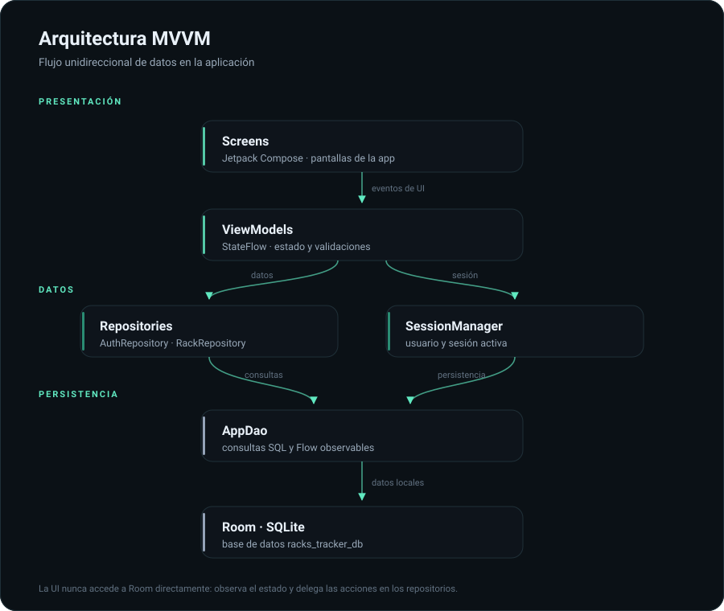
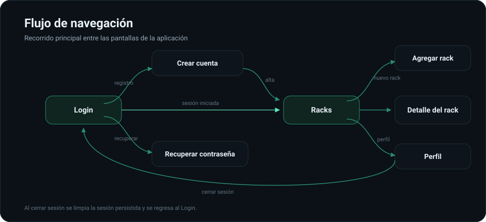

<div align="center">

# 🖥️ Racks Tracker

### Inventario de racks, claro y bajo control

Aplicación Android para registrar, organizar y monitorear la infraestructura de racks
por **sede**, **sala** y **estado**, con acceso diferenciado para **administradores** y **usuarios**.

<br/>


[](https://github.com/moka-hubs/CasoSemestralDam)

</div>

---

## 📖 Descripción

**Racks Tracker** centraliza el inventario de racks de una organización en una sola aplicación:
permite conocer su ubicación, capacidad, nivel de ocupación y estado operativo, además de
asignar cada rack al usuario que lo registra.

La aplicación funciona **100 % en local** sobre **Room (SQLite)**, mantiene la sesión del usuario
entre ejecuciones y protege las acciones sensibles mediante un sistema de roles.

<!--
  ¿Tienes capturas de pantalla? Guárdalas en docs/screenshots y descomenta este bloque.

  <p align="center">
    
    
    
    
  </p>
-->

---

## ✨ Características

### 🔐 Autenticación y cuentas

- Inicio de sesión con validación de correo y contraseña.
- Registro de usuarios con validaciones: campos obligatorios, correo válido, contraseña de
  al menos 8 caracteres y correo no duplicado.
- Recuperación de contraseña con validación del correo ingresado (flujo de demostración).
- Sesión persistente en Room: la app recuerda al usuario al reiniciarse.
- Cierre de sesión con diálogo de confirmación.
- Perfil editable (nombre, apellido y correo).

### 🗄️ Gestión de racks

- Panel principal con métricas de racks registrados y equipos totales.
- Filtros **Mis racks** y **Todos los racks**.
- Registro de racks con nombre, código, sede, sala, posición, capacidad en U, estado y notas.
- Imagen del rack desde la **galería** o la **cámara**, visualizada con Coil.
- Ficha de detalle con información completa, porcentaje de ocupación y barra de progreso.
- Cambio de estado: **Activo**, **Inactivo** o **En mantenimiento**.

### 🎨 Experiencia de usuario

- Interfaz declarativa con **Jetpack Compose** y **Material 3**.
- Tema oscuro con acento menta y componentes visuales reutilizables.
- Animaciones de entrada en el listado y transiciones fluidas.
- Diseño **edge-to-edge** adaptado a la barra de estado del dispositivo.

---

## 👥 Roles y permisos

| Acción | Administrador | Usuario |
| :--- | :---: | :---: |
| Consultar todos los racks | ✅ | ✅ |
| Registrar nuevos racks | ✅ | ✅ |
| Ver el detalle de cualquier rack | ✅ | ✅ |
| Cambiar el estado de racks propios | ✅ | ✅ |
| Cambiar el estado de racks de otros usuarios | ✅ | ❌ |
| Editar el perfil propio | ✅ | ✅ |

> [!IMPORTANT]
> Las credenciales de prueba son datos de demostración. La base de datos local se siembra
> automáticamente la primera vez que se inicia la aplicación.

---

## 🛠️ Stack tecnológico

| Tecnología | Versión | Uso en el proyecto |
| :--- | :--- | :--- |
| [Kotlin](https://kotlinlang.org/) | 2.2.10 | Lenguaje principal |
| [Jetpack Compose](https://developer.android.com/jetpack/compose) | BOM 2026.02.01 | Interfaz de usuario declarativa |
| [Material 3](https://m3.material.io/) | — | Sistema de diseño y componentes |
| [Navigation Compose](https://developer.android.com/jetpack/compose/navigation) | 2.8.5 | Navegación entre pantallas |
| [ViewModel + StateFlow](https://developer.android.com/topic/libraries/architecture/viewmodel) | 2.8.7 | Estado y lógica de presentación |
| [Room](https://developer.android.com/training/data-storage/room) | 2.8.5 | Persistencia local (SQLite) |
| [KSP](https://github.com/google/ksp) | 2.3.6 | Procesamiento de anotaciones de Room |
| [Coil](https://coil-kt.github.io/coil/compose/) | 2.6.0 | Carga de imágenes |
| [Android Gradle Plugin](https://developer.android.com/build) | 9.2.1 | Compilación y empaquetado |

**Compatibilidad:** Android 7.0 (API 24) o superior · `compileSdk` / `targetSdk` 37 · Java 11.

---

## 🏗️ Arquitectura

El proyecto sigue el patrón **MVVM (Model – View – ViewModel)** con una capa de repositorios,
flujo de datos unidireccional y `StateFlow` como única fuente de verdad para la UI.

<p align="center">
  
</p>

| Capa | Paquete | Responsabilidad |
| :--- | :--- | :--- |
| Interfaz | `screens`, `components`, `ui.theme` | Pantallas Compose, componentes reutilizables y tema visual |
| Presentación | `viewmodel` | Estado de la UI, validaciones y coordinación de acciones |
| Datos | `repository` | Contratos e implementaciones de acceso a datos |
| Persistencia | `local` | Entidades Room, DAO, conversores y datos iniciales |
| Modelo | `model` | Entidades de dominio (`Racks`, `Usuario`) |
| Sesión | `session` | Usuario autenticado y restauración de sesión |

### Estructura del proyecto

```text
CasoSemestralDam/
├── app/src/main/java/com/example/rackstracker/
│   ├── MainActivity.kt              # Punto de entrada e inyección de dependencias
│   ├── components/                  # Botones, campos, chips y barras reutilizables
│   ├── local/                       # AppDatabase, AppDao, Converters, SesionEntity, DatabaseSeeder
│   ├── model/                       # Racks, RackStatus, Usuario, RolUsuario
│   ├── navigation/                  # Navegación y definición de rutas
│   ├── repository/                  # AuthRepository y RackRepository
│   ├── screens/                     # Login, Registro, Recuperación, Racks, Detalle, Agregar, Perfil
│   ├── session/                     # SessionManager
│   ├── ui/theme/                    # Colores, tipografía y tema
│   └── viewmodel/                   # Un ViewModel por pantalla
├── docs/                            # Diagramas SVG de arquitectura y navegación
├── gradle/libs.versions.toml        # Catálogo de dependencias y versiones
├── build.gradle.kts
└── settings.gradle.kts
```

### Modelo de datos

| Entidad | Campos principales | Clave |
| :--- | :--- | :--- |
| `Racks` | Nombre, código, sede, sala, posición, capacidad U, U ocupadas, equipos, estado, notas e imagen | `id` autogenerado |
| `Usuario` | Nombre, apellido, RUT, correo, contraseña y rol | `correo` |
| `SesionEntity` | Correo del usuario con sesión activa | `id` único |

### Flujo de navegación

<p align="center">
  
</p>

---

## 🚀 Instalación y ejecución

### Requisitos

- **Android Studio** con soporte para Android Gradle Plugin 9.2.1.
- **JDK 11** o superior.
- **Android SDK 37** instalado.
- Emulador o dispositivo físico con **Android 7.0 (API 24)** o superior.

### 1. Clonar el repositorio

```bash
git clone https://github.com/moka-hubs/CasoSemestralDam.git
cd CasoSemestralDam
```

### 2. Ejecutar la aplicación

Abre la carpeta del proyecto en Android Studio, espera la sincronización de Gradle y presiona
**Run ▶** con un emulador o dispositivo conectado.

También puedes compilar desde la terminal:

```bash
# Windows
.\gradlew.bat assembleDebug

# macOS / Linux
./gradlew assembleDebug
```

El APK de depuración se genera en:

```text
app/build/outputs/apk/debug/app-debug.apk
```

Para instalar directamente en un dispositivo conectado:

```bash
./gradlew installDebug
```

---

## 👤 Usuarios de prueba

| Correo | Contraseña | Rol |
| :--- | :--- | :--- |
| `admin@racks.com` | `admin1234` | Administrador |
| `ana@racks.com` | `ana12345` | Usuario |

---

## 📌 Notas del proyecto

> [!NOTE]
> **Alcance académico.** La información se almacena únicamente en el dispositivo, sin backend
> ni sincronización remota. La recuperación de contraseña es un flujo de demostración y la
> autenticación está pensada para un entorno de pruebas, no para producción.

- La base de datos se crea como `racks_tracker_db` e incluye usuarios y racks de ejemplo.
- La sesión se restaura automáticamente al abrir la app si existe un usuario guardado.
- Un rack nuevo se registra sin equipos; su ocupación se calcula a partir de la capacidad y las U ocupadas.

---

## 👨‍💻 Equipo

| Integrante |
| :--- |
| Marcelo Dervis |
| Joaquin Fuenzalida |
| Paulo Riveros |

<div align="center">

---

**Racks Tracker** · Proyecto académico · Octubre 2026

Hecho con Kotlin y Jetpack Compose 🚀

</div>
